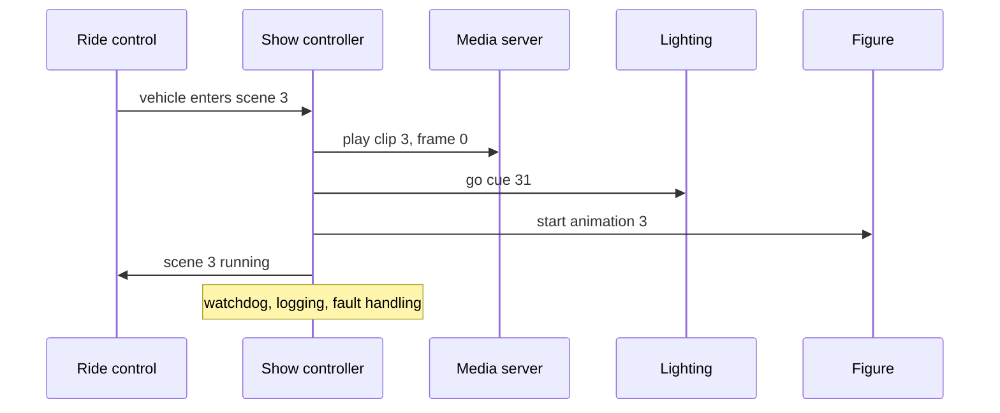

Show control is the brain that turns a script into cues. A show controller takes inputs such as a vehicle sensor, a timecode clock or an operator's button, and sends commands to media servers, lighting, audio, figures and effects over whatever protocol each speaks: serial, DMX, MIDI Show Control, OSC or network messages. MIDI Show Control was ratified in 1991 and first fully used on a Magic Kingdom parade that September; most of the languages since then have been network-based.

Two product philosophies dominate. Alcorn McBride builds non-PC controllers such as the V16X and V4X, programmed with its free WinScript Live, on the argument that a box with no operating system to patch runs reliably for a decade. Medialon, now part of 7thSense, takes the software route, managing audio, video, lighting and network devices from a PC with scheduling and automation.

The controller is deliberately not the [ride control system](../safety-standards/ride-control-systems.md). Safety lives in a certified PLC; show control only receives permissives from it, so a crashed media server can never hold a brake open. That separation, plus logging and fault handling, keeps show faults from becoming [downtime](../operations-business/downtime-and-availability.md), and it is why cue logic is checked line by line during [commissioning](../design-process/testing-and-commissioning.md).

## Explore further
- `alcorn-mcbride-show-control` — Alcorn McBride: show control, audio and video
- `7thsense-media-servers` — 7thSense: media servers and Medialon show control
- `wikipedia-midi-show-control` — MIDI Show Control
