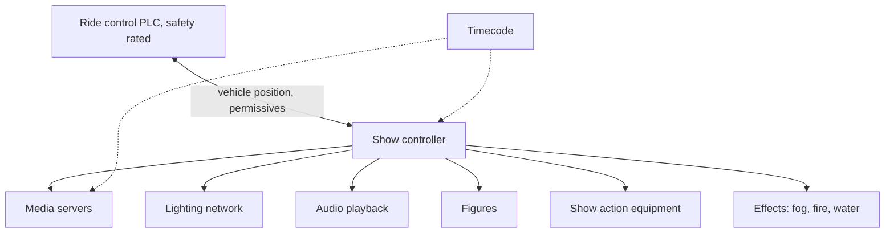

A modern attraction is a dozen systems built by a dozen vendors. The ride system knows where every vehicle is. Media servers hold terabytes of video. Lighting lives on its own network, audio on another, figures and effects on controllers of their own. Show integration is the discipline of wiring them into a single performance that starts, runs and recovers together, thousands of times a day.

At its centre sits the [show control system](../show-technology/show-control-systems.md), which takes vehicle position and permissives from the safety-rated [ride control system](../safety-standards/ride-control-systems.md) and fires cues to everything else. [Ride-show synchronization](../show-technology/ride-show-synchronization.md) is the timing problem: linear shows follow timecode, rides follow position. [Show action equipment](../show-technology/show-action-equipment.md) is the mechanised scenery that moves on those cues. [Media servers and real-time engines](../show-technology/media-servers-and-real-time-engines.md) deliver the pixels.

Integrators such as Birket Engineering specialise in exactly this seam, and John Huntington's Show Networks and Control Systems is the standard text. The work peaks during [show install](../design-process/show-install.md) and [testing and commissioning](../design-process/testing-and-commissioning.md), when every cue is walked through with the ride running, and it defines some of the most sought-after [show-tech roles](../careers/show-tech-roles.md) in the industry.

## Explore further
- `huntington-show-networks-book` — Show Networks and Control Systems
- `birket-engineering` — Birket Engineering: ride and show control integration
- `tea-connect` — Themed Entertainment Association (TEA) and SATE
