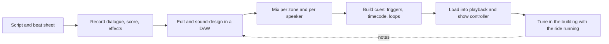

Ride audio is built in stages that mirror film post-production until the last two. It starts with the [show script](../story-experience/show-scripts.md) and beat sheet, which say what the guest should hear in each scene and for how long. Dialogue, score and effects are recorded or licensed, then edited and layered in a digital audio workstation. The mix is unusual: one mix per zone, often per speaker, because a dark ride is a chain of small rooms with their own loops and voices.

Next the audio becomes cues. Linear shows, such as a theatre pre-show, run against SMPTE timecode so every device follows one clock. Rides run on triggers from vehicle position, with background loops that never stop. Cue software like QLab handles audio, video and lighting cues with timecode, OSC and MIDI Show Control; attractions usually load final cues into dedicated controllers and players.

The last stage only happens on site. Speakers are equalised in the real room, levels are set with the ride and its fans running, and the composer hears how the score survives a moving vehicle. That is why sound is part of [show install](../design-process/show-install.md), and why [area music](../sensory-environment/area-music.md) outside the ride is mixed with the same discipline.

## Explore further
- `qlab-docs` — QLab 5 documentation
- `huntington-show-networks-book` — Show Networks and Control Systems
- `wikipedia-smpte-timecode` — SMPTE timecode
