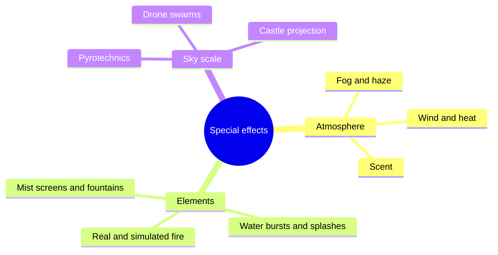

Special effects are the parts of a show that happen to the guest's body rather than to their eyes alone. A blast of heat from a dragon, mist on the face in a boat ride, the smell of oranges on Soarin', a floor-shaking firework finale: these are the moments people describe afterwards, because [multisensory](../human-factors/multisensory-integration.md) impressions are remembered as real.

The cards here are grouped by medium. [Fire, water and fog](../show-technology/fire-water-and-fog.md) covers the atmospheric and elemental effects that live inside rides. [Pyrotechnics](../show-technology/pyrotechnics.md) covers the licensed, close-audience use of flame and sparks. [Wind, heat and scent](../show-technology/wind-heat-and-scent-effects.md) are the seat-level effects of [4D theatres](../ride-systems/4d-theatres.md) and flying rides. [Water screens and fountains](../show-technology/water-screens-and-fountains.md) turn lagoons into stages, and [nighttime spectaculars](../show-technology/nighttime-spectaculars.md) scale everything up to the sky with fireworks and drones.

Every one of them is also a hazard, which is why each effect comes with a [risk assessment](../safety-standards/risk-assessment.md), an interlock and a reset time. Vendors such as Technifex build effects to run thousands of cycles a day; the design work is making a hazard reliable, safe and still surprising on the hundredth ride.

## Explore further
- `technifex-effects` — Technifex: special effects and show systems
- `wikipedia-4d-film` — 4D film
- `wikipedia-pyrotechnics` — Pyrotechnics
