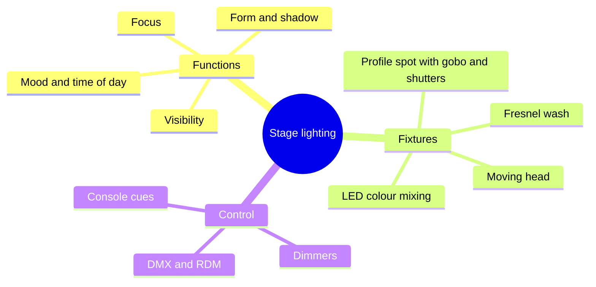

Theatrical lighting does four jobs: it makes things visible, gives them form through shadow, pulls attention to one spot, and sets mood with colour and angle. A ride borrows the whole theatre toolkit. Profile spots, or Lekos, cut hard-edged beams and can carry a gobo, a thin patterned plate that projects leaves, windows or stars. Fresnels give a soft wash. Moving heads change position, colour and beam on cue, so one fixture can replace several. LED fixtures mix red, green, blue and often amber additively, with no gels to fade.

Control runs through a console that sends cues to dimmers or directly to fixtures; the [protocol](../show-technology/lighting-control-protocols.md) is almost always DMX512 or its network carriers. In a dark ride the subtleties matter more than on stage. Guests ride through a sequence of rooms, so every fixture must light its scene without spilling into the next, and the whole level is pinned low to protect [dark adaptation](../human-factors/dark-adaptation.md). One over-bright lamp can expose the ceiling and track.

Good lighting is invisible: the guest's [attention](../human-factors/visual-attention.md) simply arrives where the designer wanted, with the [mood](../sensory-environment/lighting-mood.md) and [colour](../sensory-environment/color-psychology.md) the story needs. It remains the most direct link between [theatre staging](../story-experience/theatre-staging.md) and ride design.

## Explore further
- `wikipedia-stage-lighting` — Stage lighting
- `wikipedia-dark-ride` — Dark ride
