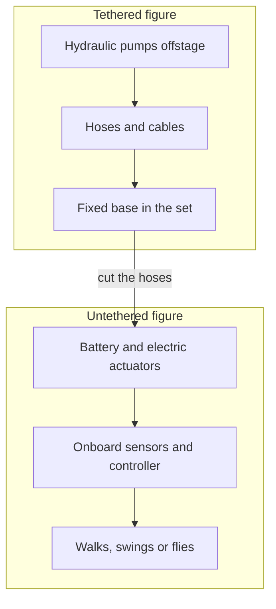

A classic figure is bolted to the floor and fed by hoses from a plant room. Cutting those ties is the frontier of show robotics. Three Disney Research projects show the range. Stuntronics is a humanoid stunt double that launches from a swing, flips, and lands in a net while controlling its pose and centre of mass; a 2019 patent application covered an inertia-shifting assembly for spin control in flight. The BDX droids are small bipedal walkers whose gaits were trained with reinforcement learning, performed as puppeteered characters at events and playtested in a park. The 2024 Robot Motion Diffusion Model generates animation-like motion that a physics controller can track, so animators can direct a walking robot the way they direct a film character.

Untethered means new constraints: battery life, electric-only [actuation](../show-technology/figure-actuation.md), a [risk assessment](../safety-standards/risk-assessment.md) for a machine that shares space with guests, and a handler nearby. It also means a character can meet people instead of waiting for a vehicle, the promise of [free-roaming robots](../ai-future/free-roaming-robots.md) and [learned figure control](../ai-future/rl-for-figures.md). Exact deployment dates and locations are not confirmed by the sources here, so this card stays at medium confidence.

## Explore further
- `disney-research-bdx-droids` — Disney Research: BDX Droids
- `blooloop-disney-stuntronics-patent` — Disney patent reveals new developments for Stuntronics
- `disney-research-robot-motion-diffusion` — Robot Motion Diffusion Model
