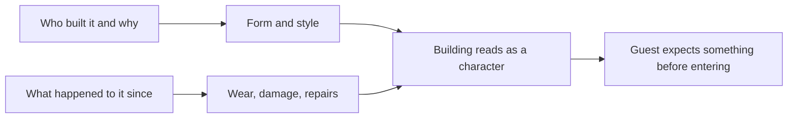

Most buildings are containers. In a themed environment the best buildings are characters: they have a history, a mood and an intention toward the guest. The Hollywood Tower Hotel at Disney's Hollywood Studios is the clearest case. Its overgrown gardens, cracked facade and scorched wing tell you about the 1939 lightning strike before any pre-show does. The hotel is the villain.

John Hench wrote about how a building's shapes and colours carry emotional messages that guests read instantly. Expedition Everest's mountain is another character: it is called the Forbidden Mountain, not Everest, and the queue's ransacked temple murals warn you it belongs to the yeti. The structure stands 199.5 feet, just below the height that would require aircraft warning lights, so nothing breaks its silhouette.

This idea sits between [central icon](../masterplanning/central-icon.md) planning and [themed facade](../design-process/themed-facades.md) craft, and it leans on [rockwork](../design-process/rockwork.md) and aging. Its payoff is [anticipation and dread](../human-factors/anticipation-and-dread.md): a building with a personality sets a mood long before the ride starts, which is the cheapest pre-show there is.

## Explore further
- `wikipedia-tower-of-terror` — The Twilight Zone Tower of Terror
- `wikipedia-expedition-everest` — Expedition Everest
- `hench-designing-disney` — Designing Disney: Imagineering and the Art of the Show
