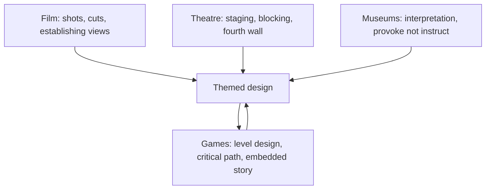

Walt Disney staffed WED Enterprises in the 1950s with film people: art directors, animators and layout artists. They designed Disneyland the way they designed a movie, and the vocabulary stuck. Since then the trade has borrowed from three more crafts, and lent back to one of them.

From film comes [cinematic grammar](../story-experience/cinematic-grammar.md): establishing views, close-ups, cuts expressed as doorways. From theatre comes [staging](../story-experience/theatre-staging.md): sightlines, blocking and the fourth wall that themed role-play removes. From museums and national parks comes [interpretation](../story-experience/exhibit-interpretation.md), Freeman Tilden's craft of making a place mean something rather than just explaining it. From games come [level design parallels](../story-experience/level-design-parallels.md), which is the one that flowed the other way first: Don Carson, an ex-Imagineer, taught game designers park tricks in 2000, and games have been returning the favour with real-time tools ever since.

Knowing the borrowed vocabularies is a career skill in itself, covered under [storytelling for designers](../careers/storytelling-for-designers.md), and it explains why [creative roles](../careers/creative-roles.md) on a project span writers, directors and game designers. [Real-time engines](../ai-future/real-time-engines.md) are the newest import.

## Explore further
- `carson-environmental-storytelling-2000` — Environmental Storytelling (Don Carson, 2000)
- `hench-designing-disney` — Designing Disney: Imagineering and the Art of the Show
- `tilden-interpreting-our-heritage` — Interpreting Our Heritage
- `bordwell-film-art` — Film Art: An Introduction
