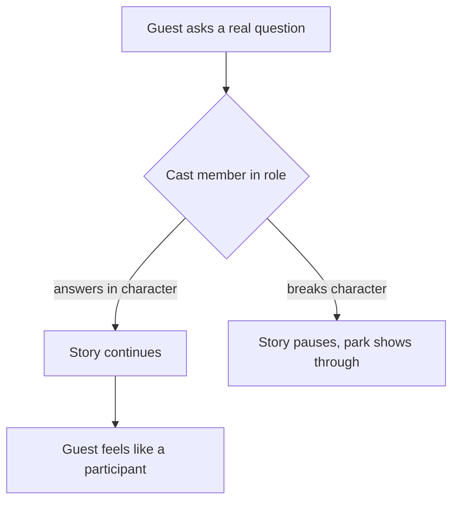

Disney calls its employees cast members and its public areas onstage; the metaphor is theatre. Role-play takes it further: a ride operator is a Resistance recruiter, a shopkeeper on Batuu has never heard of Florida, and the skipper on Jungle Cruise is a slightly unhinged riverboat captain. The script for these roles is less a set of lines than a set of rules about what the character knows and how they treat the guest.

Scott Trowbridge has argued that traditional attractions leave guests "kind of invisible": the pirates never look at you. At Galaxy's Edge the cast is trained to acknowledge guests as fellow inhabitants, and the Galactic Starcruiser hotel (2022 to 2023) pushed role-play to a two-night story where guests chose sides. Its closure shows the limits: that depth is expensive and not everyone wants it.

Role-play erases the theatrical [fourth wall](../story-experience/theatre-staging.md), strengthens [presence](../human-factors/presence.md), and is the human answer to [operational intrusion](../human-factors/operational-intrusion.md). It also reshapes [service culture](../operations-business/service-culture.md) and [staffing](../operations-business/ride-operations-staffing.md), because a character still has to answer real questions about toilets and lost children.

## Explore further
- `laughingplace-galaxys-edge-behind-the-details` — Go Behind the Details of Star Wars: Galaxy's Edge
- `wikipedia-galactic-starcruiser` — Star Wars: Galactic Starcruiser
- `wikipedia-fourth-wall` — Fourth wall
