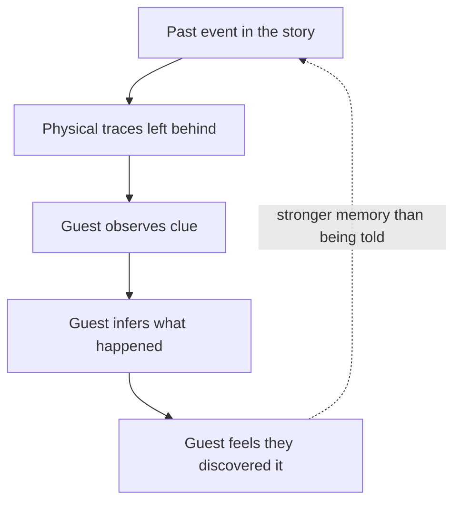

Environmental storytelling is story told by the place, not by a narrator. The designer imagines what happened here before the guest arrived, then leaves the traces: a broken fence, a half-finished meal, scorch marks on a wall. The guest reads the clues and reconstructs the event. Because they worked it out themselves, it sticks.

Former Imagineer Don Carson gave the practice its name in a 2000 essay for game developers, arguing that theme parks had long used "cause and effect" clues to pull people into a world. Harvey Smith and Matthias Worch's GDC 2010 talk "What Happened Here?" turned it into a game design discipline, and Henry Jenkins calls the broader idea narrative architecture. At Disney's Animal Kingdom, Imagineers aged the safari roads with potholes and dented the boats so the places felt lived in.

The toolkit includes [set dressing and props](../story-experience/set-dressing-and-props.md), [faux finishes and aging](../sensory-environment/faux-finishes-and-aging.md), and [ground-plane storytelling](../sensory-environment/ground-plane-storytelling.md). The same craft now flows back from games through [level design parallels](../story-experience/level-design-parallels.md).

## Explore further
- `carson-environmental-storytelling-2000` — Environmental Storytelling (Don Carson, 2000)
- `gdc-2010-what-happened-here` — What Happened Here? Environmental Storytelling (GDC 2010)
- `jenkins-narrative-architecture` — Game Design as Narrative Architecture
