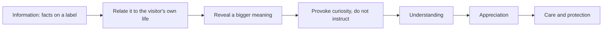

Interpretation is the museum and national-park word for the craft of helping visitors find meaning in a place. Freeman Tilden set it out in Interpreting Our Heritage (1957) after years working with the US National Park Service. His line is still quoted on ranger walls: through interpretation, understanding; through understanding, appreciation; through appreciation, protection. The National Association for Interpretation today defines it as purposeful communication that creates meaningful, relevant experiences.

Tilden's principles map neatly onto themed design. Relate everything to the visitor's own experience: do not describe a Himalayan village, let them book a trek there. Interpretation is revelation based on information, not information itself: the yeti museum in Expedition Everest's queue is a working exhibit with real artefacts, but its job is to make you believe in the mountain. Aim to provoke, not instruct. And speak differently to children than to adults.

The borrowed craft shows up in [signage and graphics](../design-process/signage-and-graphics.md) that read as props rather than labels, in [localisation](../human-factors/localisation.md) and respect for [cultural differences](../human-factors/cultural-differences.md), and in why the best themed places leave a durable [narrative memory](../human-factors/narrative-memory.md).

## Explore further
- `tilden-interpreting-our-heritage` — Interpreting Our Heritage
- `wikipedia-freeman-tilden` — Freeman Tilden
- `nai-what-is-interpretation` — National Association for Interpretation
