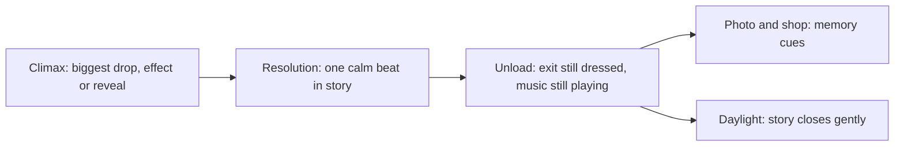

The finale is the last big beat; the unload is everything after it until daylight. Psychology says these two decide the memory. Daniel Kahneman's peak-end rule finds that people judge an experience by its most intense moment and its ending, so a weak last minute can undo a strong ride.

Tower of Terror ends with its randomised drop sequence, then a short, quiet corridor where Rod Serling signs off. Rise of the Resistance finishes with an escape pod drop and a crash landing back on Batuu, so the story resolves before the doors open. The Haunted Mansion plays its finale as a joke: a hitchhiking ghost appears beside you in the mirror. In each case the exit stays in character: no bare concrete, no sudden fluorescent light.

Design rules follow. Put the strongest effect late, not first. Give one beat of resolution after it. Keep the [unload](../operations-business/load-unload-design.md) dressed and scored. Place the [on-ride photo](../human-factors/photo-moments.md) and the [exit shop](../masterplanning/food-and-retail-placement.md) as memory cues, not ambushes. Then let the [peak-end rule](../human-factors/peak-end-rule.md) do its work.

## Explore further
- `wikipedia-tower-of-terror` — The Twilight Zone Tower of Terror
- `wikipedia-rise-of-the-resistance` — Star Wars: Rise of the Resistance
- `wikipedia-the-haunted-mansion` — The Haunted Mansion
