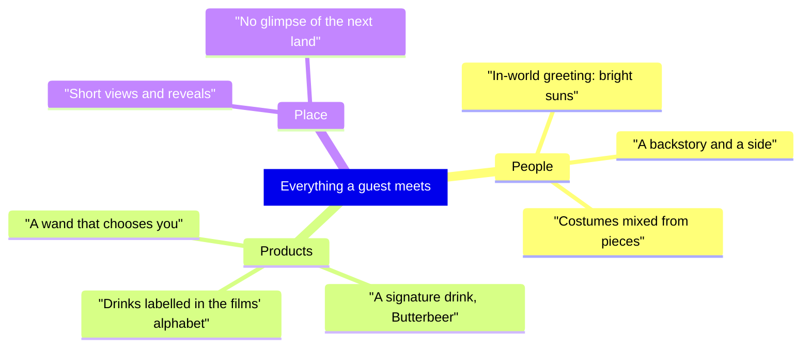

A total-immersion land tries to keep everything from the outside world out of view, so guests feel they have stepped into a story rather than walked past its decoration; see [theme versus decoration](../story-experience/theme-vs-decoration.md). Theming reaches past buildings to people, products and words.

[Galaxy's Edge](../history/galaxys-edge.md) is the fullest example. Its cast are residents of Batuu: they greet guests with "bright suns", carry a backstory and a loyalty, and choose costume pieces; see [cast role-play](../story-experience/cast-role-play.md). Coca-Cola drinks come in round bottles labelled in Aurebesh, the films' alphabet, an idea Imagineers took from the company's foreign-language signs. At the Wizarding World, Universal sought Rowling's approval for the Butterbeer recipe.

The plan lives in a [story bible](../story-experience/story-bible.md) that covers products and staff as well as places. The cost is control: every licensed product, real-world logo and modern convenience has to be negotiated or disguised, and a single plain vending machine can [break immersion](../human-factors/breaking-immersion.md).

## Explore further
- `clickondetroit-galaxys-edge-immersion` — Star Wars: Galaxy's Edge: Is it the most immersive land Disney has built?
- `disneytouristblog-thermal-detonator-bottles` — Star Wars Land's Coca-Cola Thermal Detonators
- `cbsnews-wizarding-world-opens-2010` — Harry Potter Theme Park Opens to Eager Muggles
- `wikipedia-wizarding-world-orlando` — The Wizarding World of Harry Potter (Universal Orlando)
