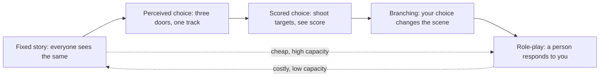

Agency is the feeling that what you do matters to the story. Most rides give none: the track is fixed and the show plays the same for everyone. Designers add agency in steps, and each step costs capacity. The cheapest is perceived choice. Disneyland's Indiana Jones Adventure shows three doors and announces which one you have been assigned, but every vehicle takes the same route; the illusion of three rides did the work.

The next step is scored interaction, as in shooting dark rides. Beyond that lies true branching, where a choice changes the scene, and finally live role-play, where a person responds to you. Immersive theatre has mapped this range, from simple acknowledgement of the audience to full co-authorship. Disney's Galactic Starcruiser offered Resistance, smuggler or First Order storylines over two nights through an app; it was praised for immersion and closed in 2023 on price.

The trade-off is the heart of [agency versus spectacle](../human-factors/agency-vs-spectacle.md). More choice means more versions to build and smaller groups, which [throughput math](../operations-business/throughput-math.md) punishes. [Interactive dark rides](../ride-systems/interactive-dark-ride.md), [wearables](../operations-business/wearables-and-identity.md) and future [personalised dark rides](../ai-future/personalized-dark-rides.md) are attempts to buy agency without losing capacity.

## Explore further
- `wikipedia-galactic-starcruiser` — Star Wars: Galactic Starcruiser
- `wikipedia-indiana-jones-adventure` — Indiana Jones Adventure
- `wikipedia-immersive-theater` — Immersive theater
- `leisure-opportunities-trowbridge-iaapa-2017` — Trowbridge: Galaxy's Edge will change the lens on who the protagonist is
