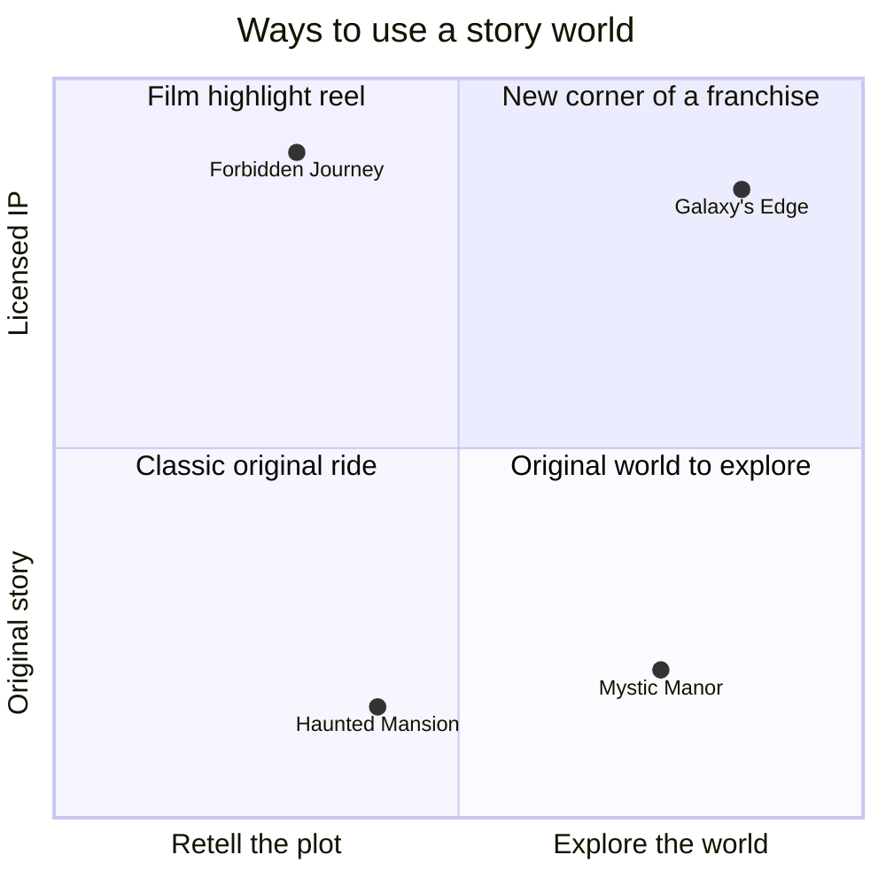

A film is ninety minutes of someone else's plot. A park is a place you walk through at your own pace. That difference is why Joe Rohde says Imagineering builds "story worlds, not necessarily story plots". The trap with licensed intellectual property (IP) is recreating scenes from the movie while leaving the guest as a bystander.

The current approach is to find a new corner of the world. Star Wars: Galaxy's Edge is set on Batuu, a planet invented for the land, so nobody knows the ending. Thierry Coup has described Forbidden Journey as a Potter "highlight reel", and Universal slowed Gringotts down to one location in response. Original stories have their own strength: Hong Kong Disneyland's Mystic Manor was written for its audience, dropping ghosts entirely for cultural reasons.

The choice interacts with [licensing economics](../operations-business/ip-licensing-economics.md), the industry's [IP wars](../history/ip-wars.md), and whether the land wants [interactive narrative](../story-experience/interactive-narrative.md). Familiar IP buys instant [nostalgia](../human-factors/nostalgia.md); an original world buys surprise. A good [story bible](../story-experience/story-bible.md) is needed either way.

## Explore further
- `hcm-rohde-iaapa-story-worlds` — Joe Rohde: we build story worlds, not story plots
- `wikipedia-galaxys-edge` — Star Wars: Galaxy's Edge
- `wikipedia-mystic-manor` — Mystic Manor
- `comcast-qa-thierry-coup` — Q&A with Thierry Coup
