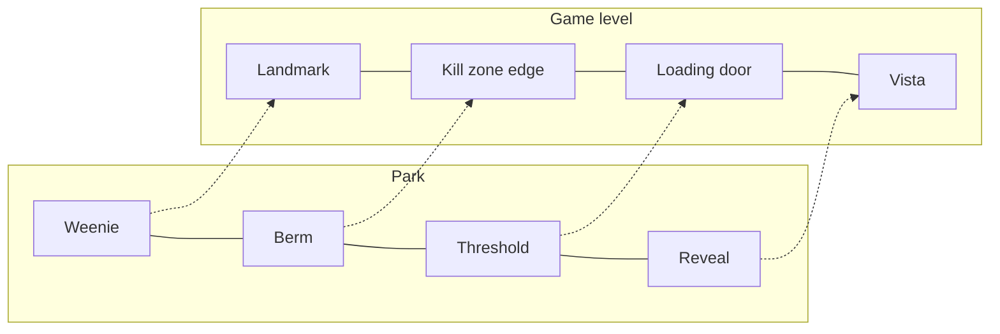

Game level designers and park designers share one job: move a person who can walk anywhere through a story in roughly the right order, without them noticing they are being steered. The tools match almost one for one. A weenie is a landmark; a berm is the edge of the playable map; a threshold is a loading door; a reveal is a vista after a corridor.

The exchange has a history. In 2000 Don Carson, formerly of Walt Disney Imagineering, wrote for game developers about what parks knew: a strong backstory, cause-and-effect clues, light and contrast as arrows. Henry Jenkins then described games as narrative architecture with evocative, enacted, embedded and emergent spaces. By 2010 Harvey Smith and Matthias Worch's GDC talk "What Happened Here?" had turned environmental storytelling into a discipline games now teach back to parks, with the Level Design Book splitting level narrative into pacing, worldbuilding, environmental storytelling and choreography.

The parallels help with [wayfinding](../human-factors/wayfinding.md) and [desire lines](../human-factors/desire-lines.md), and they are why [real-time engines](../ai-future/real-time-engines.md) and [procedural layout](../ai-future/procedural-layout.md) tools cross over. The big difference remains agency: a game can branch, a ride mostly cannot.

## Explore further
- `gdc-2010-what-happened-here` — What Happened Here? Environmental Storytelling (GDC 2010)
- `carson-environmental-storytelling-2000` — Environmental Storytelling (Don Carson, 2000)
- `jenkins-narrative-architecture` — Game Design as Narrative Architecture
- `level-design-book-storytelling` — The Level Design Book: Storytelling
