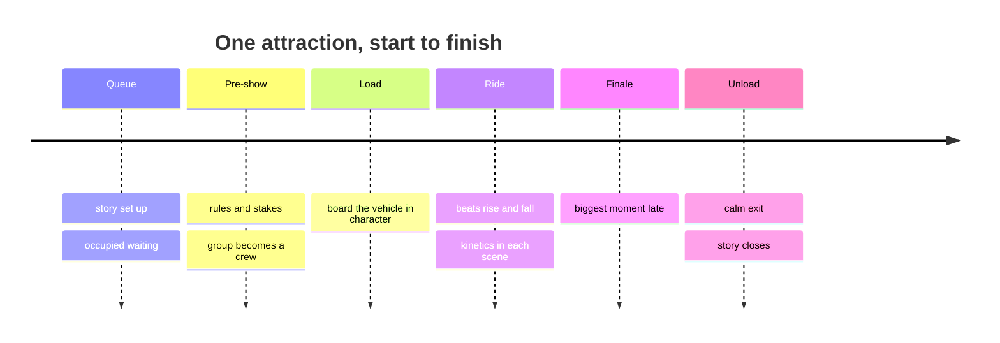

Pacing is the timing of a story; structure is its order. An attraction is unusual because the story starts long before the ride, in the queue, and ends after it, in the unload corridor. Designing the whole arc rather than just the ride is what separates a themed attraction from a themed machine.

The pieces are the [queue as story](../story-experience/queue-storytelling.md), a [ride beat sheet](../story-experience/ride-beat-sheet.md) listing every moment in order, a [tension and release curve](../story-experience/tension-and-release.md) that keeps those moments from flattening into noise, a [finale](../story-experience/finale-design.md) that lands late, and [kinetics](../story-experience/kinetics-in-scenes.md) that keep each scene alive. Rise of the Resistance is the current reference: a cave briefing, a shuttle, a hangar, a holding cell, a trackless escape and a drop, each handing the story to the next.

Pacing is also where psychology and operations meet. The [peak-end rule](../human-factors/peak-end-rule.md) says the finale and exit decide the memory. [Occupied time](../human-factors/occupied-time.md) explains why a story queue feels shorter. And the [dispatch interval](../operations-business/dispatch-interval.md) decides how long each pre-show can run.

## Explore further
- `khan-imagineering-in-a-box` — Imagineering in a Box
- `wikipedia-rise-of-the-resistance` — Star Wars: Rise of the Resistance
- `hench-designing-disney` — Designing Disney: Imagineering and the Art of the Show
