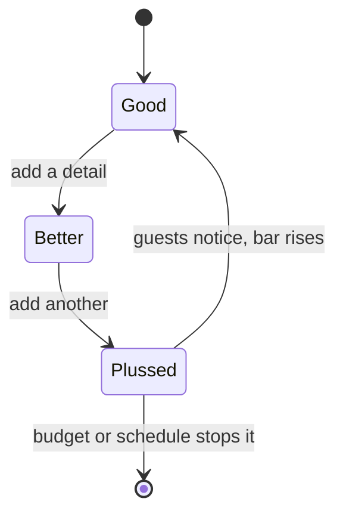

"Plussing" is Walt Disney's own verb. To plus something was to make it better than it already was, usually by adding a detail nobody had asked for. Disney said Disneyland would never be finished as long as there was imagination left in the world, and the term became an Imagineering principle: constant improvement, before and after opening.

The classic story is Jungle Cruise. The original 1955 narration played like a nature documentary. When Walt reportedly overheard a guest say they had already seen it, he asked animator Marc Davis how to improve it. Davis said it needed humour, drew the gags, and the ride became the pun-filled boat trip it is today. The attraction did not get rebuilt; it got plussed.

Plussing lives in tension with [scope and value engineering](../design-process/scope-and-value-engineering.md), which pushes the other way. It is also a formal phase in modern practice, [post-opening plussing](../design-process/post-opening-plussing.md), and the main source of the small [surprises](../human-factors/surprise-and-delight.md) repeat guests collect. Treat it as a budget line, not a hope.

## Explore further
- `wikipedia-walt-disney-imagineering` — Walt Disney Imagineering
- `imagineering-way-2003` — The Imagineering Way
- `wikipedia-jungle-cruise` — Jungle Cruise
