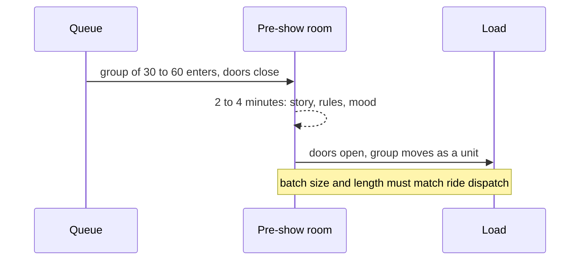

A pre-show is a short performance between the queue and the ride. Doors close behind a group, something happens, and doors open on the other side. It does three things at once: delivers the story's setup in one hit, states the rules (keep hands inside, hold on), and turns a crowd of strangers into a group that will ride together.

The Haunted Mansion's stretching room (Disneyland, 1969) is the archetype. The portraits lengthen, the ceiling vanishes, and a voice points out there are no windows and no doors. At Disneyland the room is actually an elevator taking you under the railroad berm to the show building. The Tower of Terror's library has a thunderclap, a dead television and Rod Serling inviting you into a maintenance elevator. Rise of the Resistance has two in sequence: Rey's briefing and the transport shuttle that gets captured.

Pre-shows are an operations problem as much as a story one. Their batch size and length must divide neatly into the ride's [throughput](../operations-business/throughput-math.md), they run on [show control](../show-technology/show-control-systems.md), and they often use illusions such as [Pepper's ghost](../show-technology/peppers-ghost.md). They also shape [group dynamics](../human-factors/group-dynamics.md): shared fright in a closed room is bonding.

## Explore further
- `wikipedia-the-haunted-mansion` — The Haunted Mansion
- `wikipedia-tower-of-terror` — The Twilight Zone Tower of Terror
- `wikipedia-rise-of-the-resistance` — Star Wars: Rise of the Resistance
