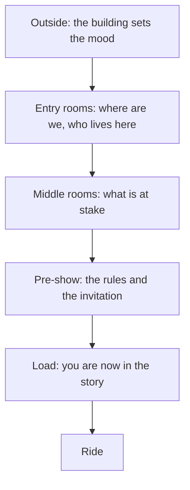

A queue is the one place a park has a captive audience for twenty minutes or more. Queue storytelling spends that time on the first act: where you are, who lives here and what is about to go wrong. By the time guests board, they already know the stakes, so the ride can start at speed.

Universal's Harry Potter and the Forbidden Journey (Islands of Adventure, 2010) is the benchmark. The line winds through Hogwarts: greenhouses, a portrait gallery of more than a hundred paintings that talk to each other, Dumbledore's office, and the Defence Against the Dark Arts classroom where Harry, Ron and Hermione invite you to a secret Quidditch match. The Indiana Jones Adventure queue adds puzzles: a cipher on the walls and props you can push and pull. Expedition Everest uses a travel agency office and a yeti museum to explain the mountain.

The craft draws on [occupied time](../human-factors/occupied-time.md) and [interactive queues](../human-factors/interactive-queues.md), fights [queue boredom](../human-factors/queue-boredom.md), and reshapes [switchback design](../human-factors/switchback-design.md) so each turn reveals a new room. Its two formal tools are the [pre-show](../story-experience/pre-show.md) and treating [load as a story moment](../story-experience/load-as-story.md).

## Explore further
- `orlandoparkstop-forbidden-journey-facts` — 10 Magical Facts about Harry Potter and the Forbidden Journey
- `wikipedia-forbidden-journey` — Harry Potter and the Forbidden Journey
- `wikipedia-indiana-jones-adventure` — Indiana Jones Adventure
