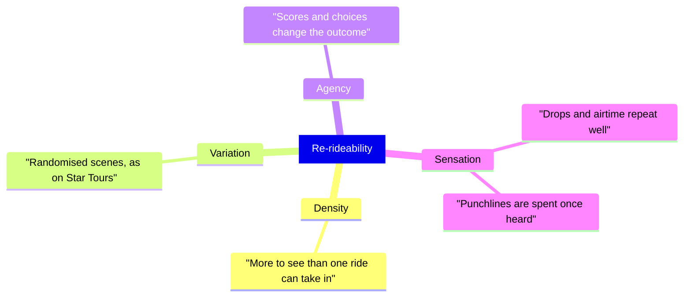

Re-rideability is how much a guest wants to ride again after the first time. Operators prize it because a returning guest costs less to win than a new one, an argument Wendover Productions makes about Disney.

Designers have four levers. Density: pack more into each scene than one viewing can absorb, so every ride shows something new. Variation: Star Tours – The Adventures Continue, opened in 2011, builds each flight from a pool of film segments; Wikipedia counts about 1,500 possible journeys on its [motion simulator](../ride-systems/motion-simulator-theatre.md). Agency: scores and choices, as in [interactive narrative](../story-experience/interactive-narrative.md), change the outcome. Sensation: a drop or airtime works on the tenth ride as on the first, while a joke loses its force once heard, one reason big story rides lean on physical drama.

Over years, [plussing](../story-experience/plussing.md) refreshes a ride. Novelty alone is a weak lever: [Galactica's VR overlay](../ai-future/galactica-vr-coaster.md) was removed after guest feedback. Re-ride intent feeds [attendance modelling](../operations-business/roi-and-attendance-modeling.md). Confidence is medium because these levers are design heuristics rather than measured effects.

## Explore further
- `wikipedia-star-tours-adventures-continue` — Star Tours – The Adventures Continue
- `wendover-how-to-design-a-theme-park` — How to Design a Theme Park (To Take Tons of Your Money)
- `wikipedia-galactica-roller-coaster` — Galactica (roller coaster)
