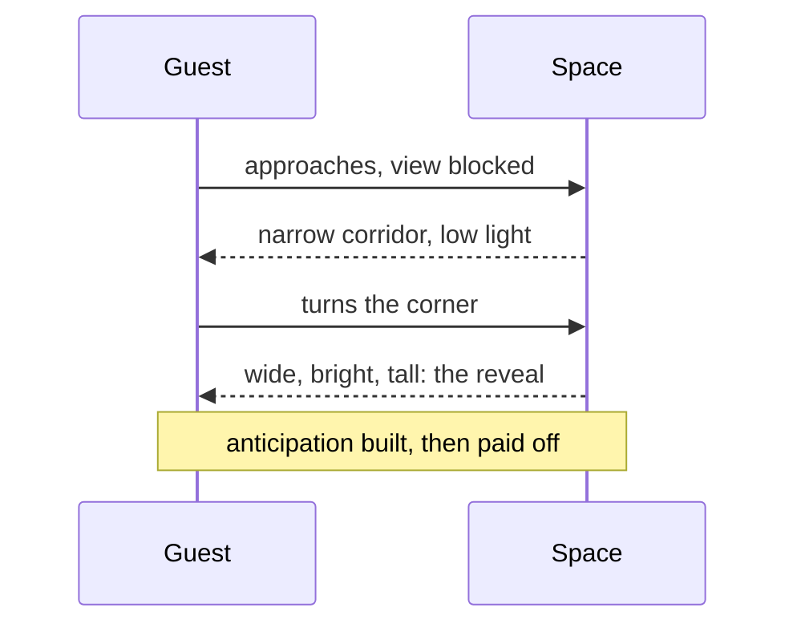

A reveal is the moment a space suddenly opens up: the corridor ends and the hangar is there. Concealment is everything before it. Designers hide the big view on purpose so that it arrives as a payoff rather than a background. Don Carson calls this framing: let guests glimpse part of a structure through a gap or a window so they want to see the rest.

Rise of the Resistance is built as a chain of reveals. You pass through a cave base, a cramped transport shuttle, then step out into a full-size Star Destroyer hangar with rows of stormtroopers. The shuttle is small and dark precisely so the hangar feels enormous. Disneyland's Haunted Mansion does it in reverse: the stretching room shrinks your world before the ride expands it.

Reveals are the spatial form of [tension and release](../story-experience/tension-and-release.md) and the main trigger for [awe](../human-factors/awe.md). Concealment builds [anticipation](../human-factors/anticipation-and-dread.md) and gives [misdirection](../show-technology/misdirection.md) somewhere to hide. Even a [switchback queue](../human-factors/switchback-design.md) can be planned so each turn offers a new partial view rather than the same wall.

## Explore further
- `carson-environmental-storytelling-part-2` — Environmental Storytelling, Part II
- `wikipedia-rise-of-the-resistance` — Star Wars: Rise of the Resistance
- `hench-designing-disney` — Designing Disney: Imagineering and the Art of the Show
