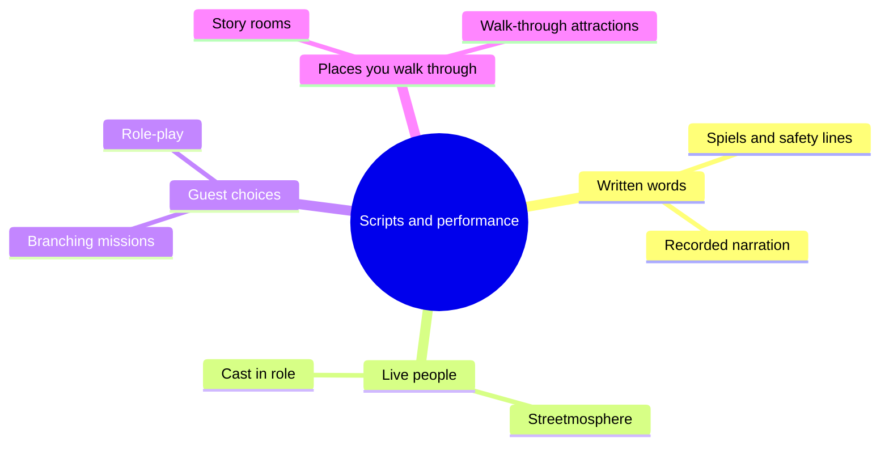

Most of this land is about buildings and space. This part is about words and people. A story can be told by a recorded voice, by a cast member in a hat, by letting guests make a choice, or by handing them a room to explore at their own speed. Each of these is a performance, and each needs a script, even when the script is a set of rules rather than lines.

The four tools are [show scripts and spiels](../story-experience/show-scripts.md), [cast and character role-play](../story-experience/cast-role-play.md), [interactive narrative](../story-experience/interactive-narrative.md) and [story rooms and walkthroughs](../story-experience/story-rooms-and-walkthroughs.md). Jungle Cruise still depends on a live skipper; Galaxy's Edge trains its cast to treat guests as locals of Batuu; the Galactic Starcruiser hotel tried a two-night branching story; Punchdrunk's Sleep No More shows how far a masked, free-roaming audience can go.

Performance meets operations in [service culture](../operations-business/service-culture.md), [operator training](../safety-standards/operator-training.md) and [entertainment scheduling](../operations-business/entertainment-scheduling.md). The design question underneath all of it is [agency versus spectacle](../human-factors/agency-vs-spectacle.md): how much of the story should the guest be allowed to change?

## Explore further
- `wikipedia-jungle-cruise` — Jungle Cruise
- `wikipedia-galactic-starcruiser` — Star Wars: Galactic Starcruiser
- `leisure-opportunities-trowbridge-iaapa-2017` — Trowbridge: Galaxy's Edge will change the lens on who the protagonist is
