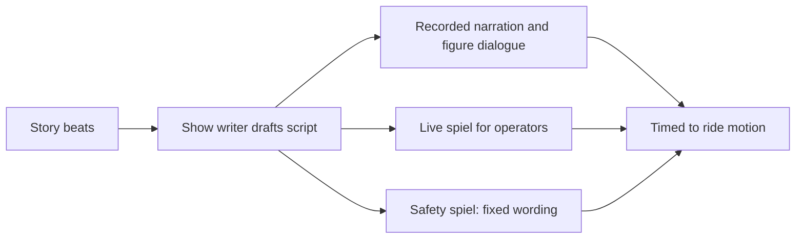

A spiel is theme-park slang for any spoken script: the recorded voice in a pre-show, the dialogue of an animatronic figure, or the live patter of a boat skipper. Show writers draft them from the beat sheet, then cut them hard, because a line that runs longer than the scene it belongs to is a line guests never hear finished.

Jungle Cruise is the live-spiel classic. The 1955 version was narrated like a nature documentary; after Marc Davis added gags, it became a pun routine delivered by a skipper who loosely follows a script and improvises around it. The Haunted Mansion's Ghost Host and the Tower of Terror's Rod Serling (voiced by sound-alike Mark Silverman) show the recorded version: one voice carries the rules, the stakes and the tone in under two minutes.

Scripts also carry the safety message, which is why [rider compliance](../human-factors/rider-compliance.md) depends on how a line is written and delivered, and why [operator training](../safety-standards/operator-training.md) rehearses it. Delivery runs through [onboard and spatial audio](../show-technology/onboard-and-spatial-audio.md), and international parks need [multilingual](../human-factors/multilingual-design.md) versions: Hong Kong's skippers spiel in three languages.

## Explore further
- `wikipedia-jungle-cruise` — Jungle Cruise
- `wikipedia-tower-of-terror` — The Twilight Zone Tower of Terror
- `khan-imagineering-in-a-box` — Imagineering in a Box
