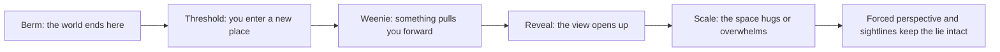

Spatial storytelling is the half of themed design that happens with geometry instead of words. Guests walk. As they walk, the designer controls what they can see, how far away it looks, where the edge of the world is, and when a big view is allowed to open up. Each of those is a sentence in the story.

The vocabulary comes mostly from Disneyland in 1955 and John Hench's later writing. A [weenie](../story-experience/weenies.md) pulls people toward a destination. [Forced perspective](../story-experience/forced-perspective.md) makes streets longer and castles taller. The [berm](../story-experience/the-berm.md) hides the outside world, and [sightline](../story-experience/sightlines.md) discipline keeps show buildings and cranes out of frame. [Thresholds](../story-experience/thresholds-and-portals.md) mark the change from one land to the next, and [reveals](../story-experience/reveal-and-concealment.md) decide when the payoff arrives.

These tools belong to [land design](../masterplanning/land-design.md) and the [entry sequence](../masterplanning/entry-sequence.md) as much as to story. They are also how [wayfinding](../human-factors/wayfinding.md) works without signs. Don Carson's point is that game level designers borrowed all of it.

## Explore further
- `hench-designing-disney` — Designing Disney: Imagineering and the Art of the Show
- `carson-environmental-storytelling-part-2` — Environmental Storytelling, Part II
- `mouseplanet-origin-of-wienie` — The Origin of the Disneyland Wienie
