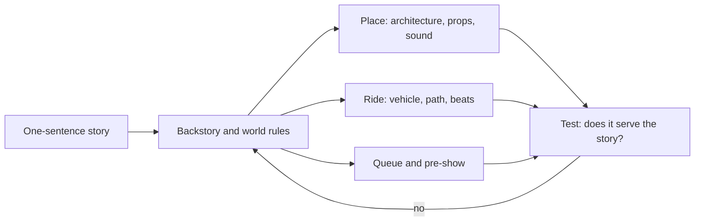

Story-driven design means the story is written before the ride is engineered or the building is drawn. The story becomes a filter. Every later choice, from the colour of a railing to the shape of the vehicle, has to answer the question "does this serve the story?" If it does not, it is cut or changed. Marty Sklar's rules for Imagineers put it bluntly: tell one story at a time.

A good example is Expedition Everest at Disney's Animal Kingdom. The attraction is not "a coaster with a yeti"; it is a trip run by a fictional travel agency, Himalayan Escapes, out of the village of Serka Zong. That one idea decides the queue (a booking office and a tea warehouse), the vehicle (an old mountain train) and the climax.

The practical tools are a written [story bible](../story-experience/story-bible.md), a [three-act structure](../story-experience/three-act-ride.md), and a clear [design intent](../design-process/design-intent.md) statement that survives [value engineering](../design-process/scope-and-value-engineering.md). Done well, it is what lets guests feel [transported](../human-factors/narrative-transportation.md) rather than entertained.

## Explore further
- `khan-imagineering-in-a-box` — Imagineering in a Box (Walt Disney Imagineering + Khan Academy)
- `prosperi-imagineering-pyramid` — The Imagineering Pyramid
- `sklar-one-little-spark` — One Little Spark!: Mickey's Ten Commandments
- `wikipedia-expedition-everest` — Expedition Everest
