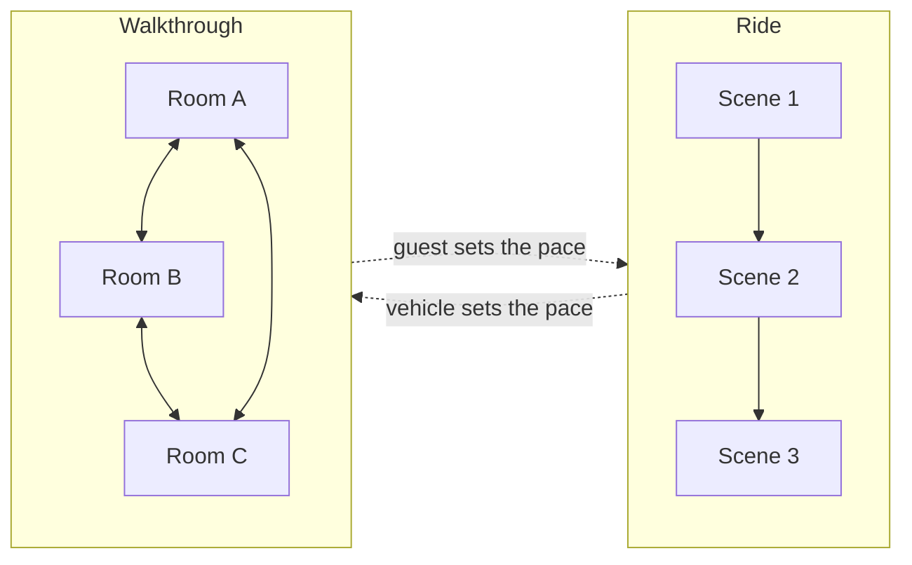

A walkthrough is an attraction without a vehicle. Guests move through a sequence of dressed rooms on foot, and the pace is theirs. Disneyland's Sleeping Beauty Castle walkthrough opened in 1957 with dioramas of the film's story, closed in 2001 and reopened in 2008; it is small, but it is the ancestor of every story room since. Modern rides hide walkthrough sections inside them: Rise of the Resistance makes you walk a Star Destroyer hangar between two ride systems.

Immersive theatre pushed the form furthest. Punchdrunk's Sleep No More (New York, 2011 to 2025) spread a wordless Macbeth over five floors of a fake hotel; masked audiences wandered freely and found their own story. The lesson for parks is that rooms can carry narrative alone if each one implies an event, which is where [environmental storytelling](../story-experience/environmental-storytelling.md) and [set dressing](../story-experience/set-dressing-and-props.md) do the work.

Walkthroughs reward [play and exploration](../human-factors/play-and-exploration.md) and suit [location-based entertainment](../ai-future/location-based-entertainment.md), but they trade the predictable capacity of a [classic dark ride](../ride-systems/classic-dark-ride.md) for messy [guest flow](../masterplanning/guest-flow-patterns.md): people stop, bunch and double back.

## Explore further
- `wikipedia-sleep-no-more` — Sleep No More (2011 play)
- `wikipedia-sleeping-beauty-castle` — Sleeping Beauty Castle
- `wikipedia-immersive-theater` — Immersive theater
