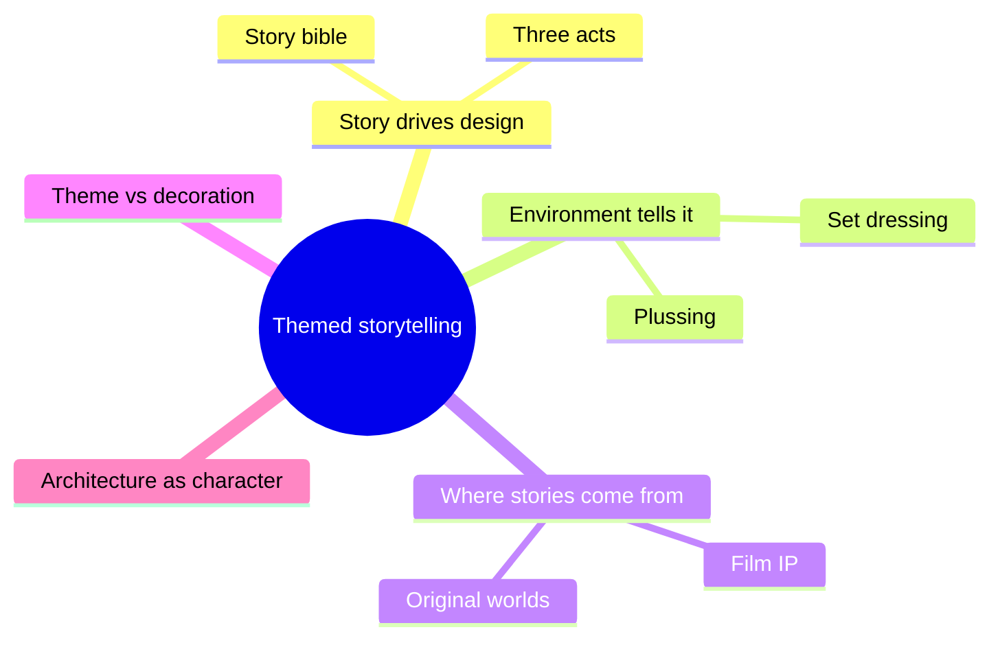

Themed storytelling is the idea that a park, land or ride is a story made of places rather than a decorated amusement area. Imagineers call this the first principle: it all begins with a story. The story decides what the building looks like, what the queue sounds like and what the ride vehicle is pretending to be.

The story is rarely told as a plot with a beginning, middle and end. Joe Rohde describes it as building "story worlds, not necessarily story plots": the guest walks through a world that implies what happened here. That is why [story-driven design](../story-experience/story-driven-design.md) starts with a written backstory, why [environmental storytelling](../story-experience/environmental-storytelling.md) puts the plot into props and surfaces, and why [architecture can be a character](../story-experience/architecture-as-character.md).

This lens separates [theme from decoration](../story-experience/theme-vs-decoration.md) and shapes how film [IP is adapted](../story-experience/ip-adaptation.md). It is also what makes [narrative transportation](../human-factors/narrative-transportation.md) possible: a coherent world lets guests stop checking whether it is real.

## Explore further
- `khan-imagineering-in-a-box` — Imagineering in a Box (Walt Disney Imagineering + Khan Academy)
- `hench-designing-disney` — Designing Disney: Imagineering and the Art of the Show
- `prosperi-imagineering-pyramid` — The Imagineering Pyramid
- `hcm-rohde-iaapa-story-worlds` — Joe Rohde: we build story worlds, not story plots
