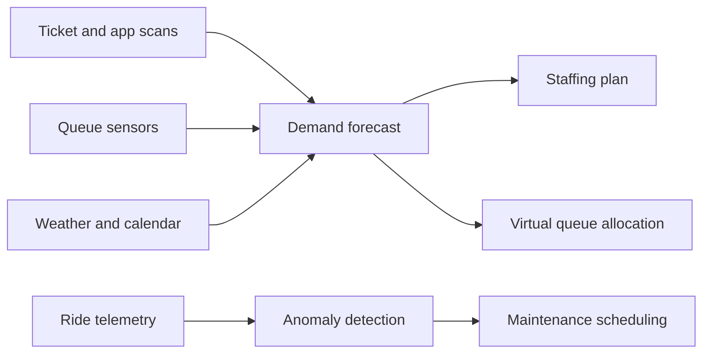

Running a park generates a huge amount of data: every ticket scan, app check-in, queue sensor and sensor on a ride vehicle. AI in operations is the practice of turning that stream into decisions. The first use is forecasting. Attendance depends on school holidays, weather, hotel bookings and what was popular last week, and a model that predicts it well lets the park schedule the right number of operators and food staff. The second use is allocation: virtual queue systems decide how many return slots to release each hour by predicting [throughput and queueing](../operations-business/throughput-and-queueing.md) for each attraction. The third is maintenance, where models watch vibration, temperature and cycle counts and flag parts before they fail. None of this replaces the ride control system or the operator; it sits above them, suggesting. The best-known guest-facing piece is [wait-time prediction](../ai-future/wait-time-prediction.md), and the honest limit is that a forecast is only as good as the [dispatch interval](../operations-business/dispatch-interval.md) the crew actually hits.

## Explore further
- [Wait-Time Prediction](../ai-future/wait-time-prediction.md) — the forecast guests see on the board.
- [Ride Control Systems](../safety-standards/ride-control-systems.md) — the layer AI advises but does not control.
