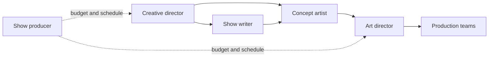

The creative side of an attraction is a small chain of handoffs. The creative director holds the overall vision and decides what the attraction is about. The show writer turns that into a story treatment, scene-by-scene beats and any dialogue; this is where [spatial storytelling](../story-experience/spatial-storytelling.md) is first worked out on paper. The concept artist draws it, producing the paintings and sketches that sell the idea internally and give engineers something to measure. The art director then takes ownership of how everything will actually look when built, choosing materials, colours and finishes and checking that fabricators match the concept. Alongside all of them, the show producer manages scope, budget and schedule, which makes them the bridge to the rest of the [concept-to-opening pipeline](../design-process/pipeline-overview.md). Titles vary between companies, and on small projects one person wears several hats, but the sequence of vision, story, image, finish and delivery is the same. This is the first of the five families described under [roles](../careers/roles.md).

## Explore further
- [Roles](../careers/roles.md) — the other four families of attraction jobs.
- [Weenies](../story-experience/weenies.md) — a classic creative tool for pulling guests through space.
