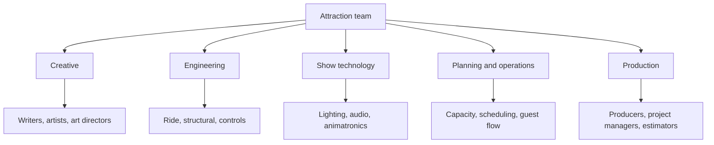

Nobody builds a ride alone, and the jobs fall into five rough families. Creative roles own the story and the look: what the guest sees, hears and feels, and why. Engineering roles make it physically real and safe: the ride system, the building, the structures, the control software. Show technology roles sit between the two, turning sketches into lighting rigs, audio systems, projection and animatronic figures. Planning and operations roles ask how many guests the thing can serve, how it fits the park and how it will be staffed. Production roles, including producers, project managers and estimators, keep budget, schedule and the other four families aligned. Which family leads shifts across the [concept-to-opening pipeline](../design-process/pipeline-overview.md): creatives dominate blue sky, engineers and producers dominate fabrication, and everyone is in the building during test and adjust. The [creative roles](../careers/creative-roles.md) card breaks down the first family, and the same approach applies to each of the others.

## Explore further
- [Creative Roles](../careers/creative-roles.md) — writers, artists and directors in detail.
- [Concept-to-Opening Pipeline](../design-process/pipeline-overview.md) — the phases these roles move through.
