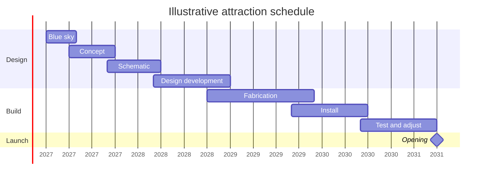

Big attractions take years, and most of that time is not drawing. A typical major ride runs about four years from the first blue-sky sessions to opening day, and the chart above shows a plausible shape rather than any real project. Notice how the phases overlap: fabrication starts before design development is fully closed, and installation begins while shops are still building later scenes. That overlap is deliberate, because a strictly one-after-another schedule would add a year or more. The cost is that late design changes become expensive once steel is cut, which is why the timeline acts as a hard limit on [scope and value engineering](../design-process/scope-and-value-engineering.md): after a certain date, cutting a scene saves little and adds risk. The longest single stretch is usually test and adjust, where [ride control systems](../safety-standards/ride-control-systems.md) are commissioned and every effect is tuned. The whole sequence sits inside the broader [concept-to-opening pipeline](../design-process/pipeline-overview.md).

## Explore further
- [Concept-to-Opening Pipeline](../design-process/pipeline-overview.md) — what each phase is for.
- [Risk Assessment](../safety-standards/risk-assessment.md) — the safety work that runs alongside the schedule.
