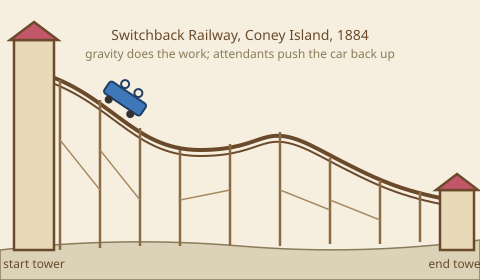

The first coasters had no motors and no lift chain. Russian ice slides of the 1700s were tall wooden ramps packed with ice and ridden on sleds, popular enough that the French still call coasters "montagnes russes". In 1817 Paris opened the Promenades Aériennes, where wheeled cars ran down a curved wooden slope with the wheels locked into the rails so they could not jump off. The idea became a true amusement in 1884, when LaMarcus Thompson opened the Switchback Railway at Coney Island. Riders climbed a tower, rolled down a gentle undulating track to a second tower, and attendants pushed the car onto a parallel track for the return. It cost a nickel and reportedly paid for itself within weeks. Everything since has chased more speed and more controlled force from the same idea, which is why these rides sit at the root of [roller coasters](../ride-systems/roller-coasters.md), contrast so sharply with modern [launched coasters](../ride-systems/launched-coasters.md), and make a gentle introduction to [track geometry](../ride-engineering/track-geometry.md).

## Explore further
- [Origins](../history/origins.md) — the wider story of where parks came from.
- [G-Force Basics](../ride-engineering/g-force-basics.md) — what changed once the hills got steeper.
