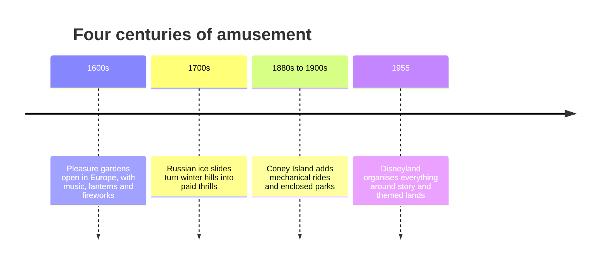

Amusement parks are older than the rides in them. In the 1600s, pleasure gardens such as Vauxhall in London offered paths, music, lanterns and fireworks for the price of admission; the idea of paying to walk around a designed place for fun starts there. In Russia, wooden slides coated in ice let riders sled down steep hills for a fee, and the French built wheeled versions in the early 1800s. The next leap came at Coney Island in the 1880s to 1900s, where cheap rail fares and a dense beachfront produced the first [roller coasters](../ride-systems/roller-coasters.md), then enclosed parks with gates, lights and themed spectacle. Disneyland in 1955 reorganised that inheritance around story: a single entrance, a [hub-and-spoke](../masterplanning/hub-and-spoke.md) plan and lands with distinct identities. Nearly everything on this site traces back to one of those four moments, and the [early coasters](../history/early-coasters.md) card follows the thrill-ride thread in more detail.

## Explore further
- [Early Coasters](../history/early-coasters.md) — the switchback railway and its ancestors.
- [Park Structure](../masterplanning/park-structure.md) — how Disneyland's layout became the template.
