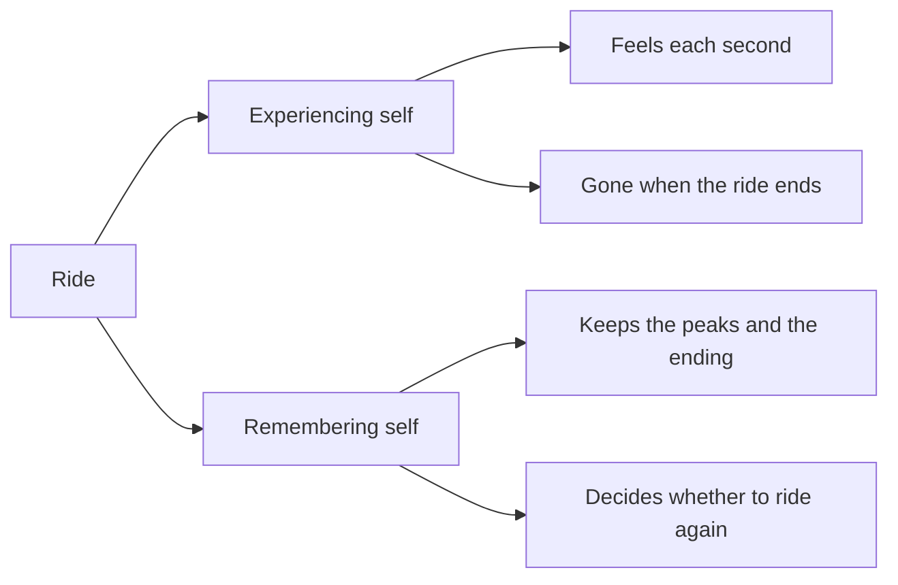

Guests do not take the ride home with them; they take the memory. Psychologist Daniel Kahneman described two selves: the experiencing self, which lives through each second, and the remembering self, which keeps a short story afterwards and makes the decisions. The remembering self is a poor accountant. It largely ignores how long something lasted and leans on a few vivid moments, a pattern captured by the [peak-end rule](../human-factors/peak-end-rule.md). For designers this changes what counts. A two-minute coaster and a twelve-minute dark ride can leave equally strong memories if their high points land. It also explains why [waiting](../human-factors/waiting.md) matters less than it seems once the ride delivers, and why [spatial storytelling](../story-experience/spatial-storytelling.md) tries to give every land a memorable payoff rather than a steady, even stream of pleasant things.

## Explore further
- [Peak-end rule](../human-factors/peak-end-rule.md) — the specific shortcut the remembering self uses.
- [Perceived vs actual wait](../human-factors/perceived-vs-actual-wait.md) — the live feeling, as opposed to the memory.
