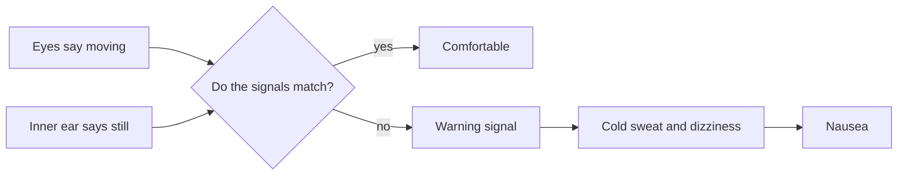

Motion sickness is what happens when the senses argue. On a simulator the eyes insist you are diving while the inner ear insists you are sitting still; on a spinning ride the inner ear reports turning that the eyes cannot confirm. The brain treats the mismatch as a sign something is wrong, and the body responds with cold sweat, dizziness and nausea. The leading explanation is [sensory conflict theory](../human-factors/sensory-conflict-theory.md). Susceptibility varies hugely between people and drops with repeated exposure, which is one reason test crews ride new attractions many times. For designers it sets real limits. Long sustained spinning, low screen frame rates and lag between motion and picture are the usual culprits, more so than high [g-forces](../ride-engineering/g-force-basics.md) on their own. Even [launched coasters](../ride-systems/launched-coasters.md) keep their most disorienting elements short, because the brain copes with brief, clearly signalled motion far better than with lingering confusion.

## Explore further
- [Sensory conflict theory](../human-factors/sensory-conflict-theory.md) — the standard account of why the mismatch makes us ill.
- [Forces and tolerance](../ride-engineering/forces-and-tolerance.md) — the physical limits that sit alongside the perceptual ones.
