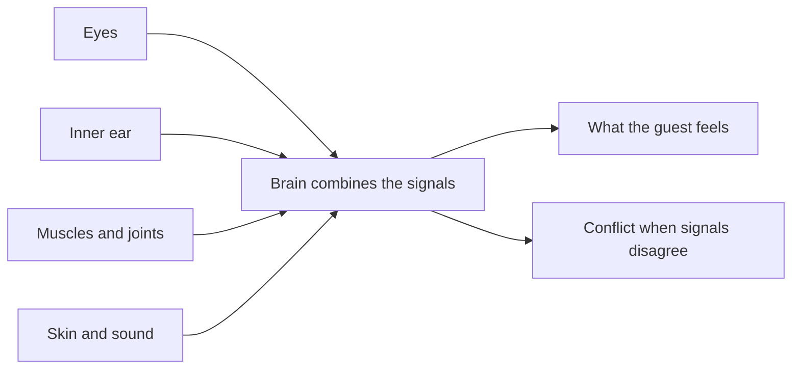

Perception is the brain's working model of what is happening, built from several senses at once. The eyes report motion and scale, the inner ear reports acceleration and tilt, the muscles report posture, and the skin and ears add wind and sound. The brain blends these into one confident feeling of where I am and what is going on. Ride designers work on this model, not on physics alone. A gentle motion base paired with a large screen can feel like a steep dive, because the eyes outvote the body. [Illusions](../show-technology/illusions.md) such as Pepper's ghost exploit the same willingness to trust a tidy picture, and careful [light and colour](../sensory-environment/light-and-color.md) can make a room feel warm, cold, safe or sinister. But when the senses disagree too strongly, the blend fails, and the result is [motion sickness](../human-factors/motion-sickness.md), explained in detail by [sensory conflict theory](../human-factors/sensory-conflict-theory.md).

## Explore further
- [Motion sickness](../human-factors/motion-sickness.md) — what happens when the senses argue.
- [Pepper's ghost](../show-technology/peppers-ghost.md) — a classic trick played on the eyes.
