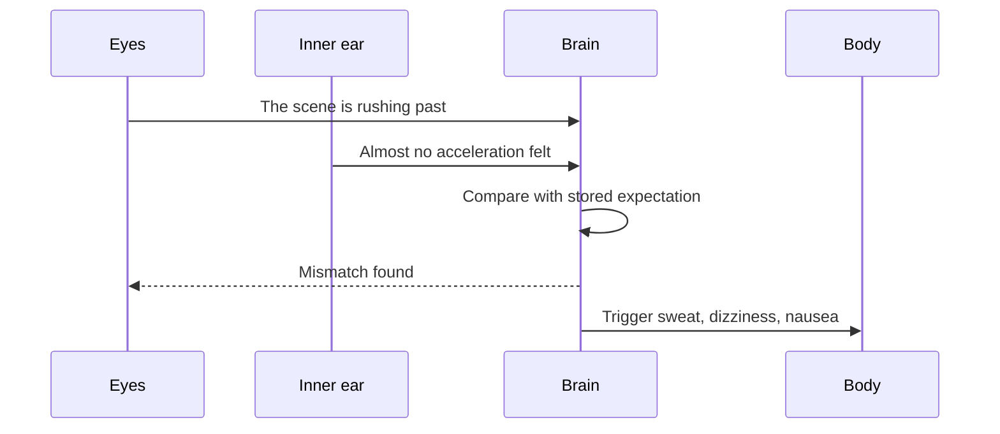

Sensory conflict theory, set out by James Reason and Joseph Brand in 1975, says that motion sickness is not caused by motion itself but by disagreement. The brain keeps a stored expectation of how the eyes, inner ear and body should report any given movement, learned from a lifetime of walking and turning. When the live signals fail to match each other, or fail to match that expectation, a conflict signal builds and sickness follows. The theory explains the puzzles: why a reader in a car feels ill, because the ear says motion while the eyes say page; why sailors adapt after a few days, because the expectation updates; and why screens with poor frame rates can be worse than real roller coasters. It is a clear example of [perception](../human-factors/perception.md) as prediction rather than passive sensing, and it is the account of [motion sickness](../human-factors/motion-sickness.md) that ride and simulator designers lean on when tuning a [g-force profile](../ride-engineering/g-force-basics.md).

## Explore further
- [Motion sickness](../human-factors/motion-sickness.md) — the symptoms and the design limits they impose.
- [Perception](../human-factors/perception.md) — how the brain blends the senses in the first place.
