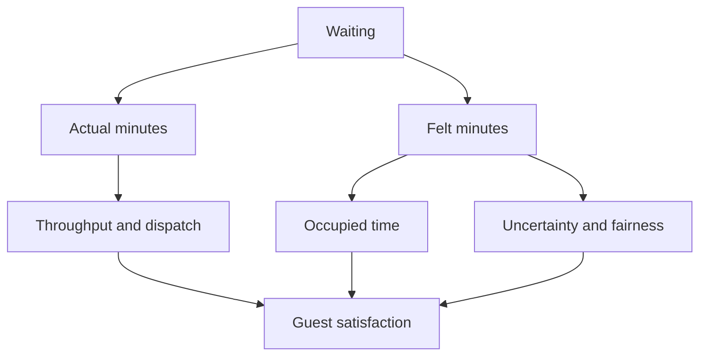

Guests spend more of a park day in queues than on rides, so waiting is a design problem in its own right. It has two sides. The actual wait is arithmetic: how many people are in line divided by how many the ride swallows per hour, which is the territory of [throughput and queueing](../operations-business/throughput-and-queueing.md). The felt wait is psychology, and it is usually the one that decides whether people complain. David Maister's classic rules say that unoccupied time feels longer than occupied time, uncertain waits feel longer than known ones, and unfair waits feel longest of all. Good queue design attacks the felt side with story, shade, things to do and honest signage, as covered under [perceived vs actual wait](../human-factors/perceived-vs-actual-wait.md) and [occupied time](../human-factors/occupied-time.md). Modern parks add [wait-time prediction](../ai-future/wait-time-prediction.md) so guests can choose their queues with open eyes.

## Explore further
- [Perceived vs actual wait](../human-factors/perceived-vs-actual-wait.md) — why the same twenty minutes can feel like fifteen or thirty.
- [Throughput math](../operations-business/throughput-math.md) — the arithmetic behind the actual number.
