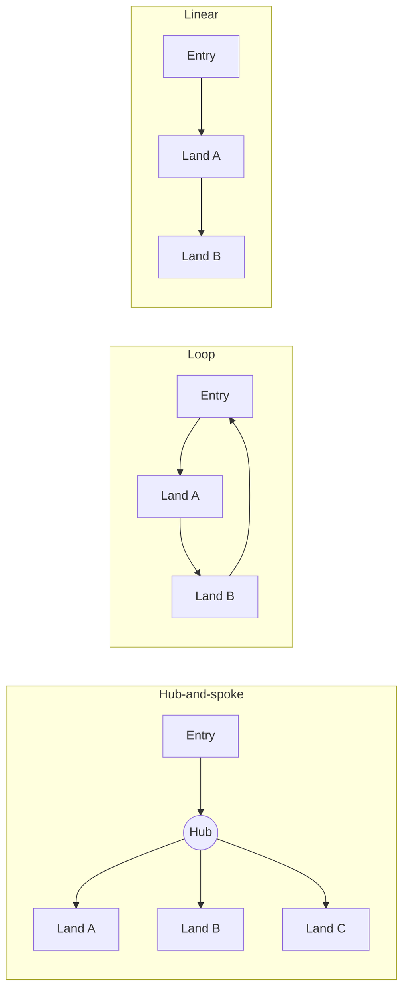

Park structure is the big-picture shape of a park: the way its entrance, paths and themed lands fit together on the ground. It is decided long before any single ride is designed, and it quietly shapes everything that follows.

Three patterns cover most parks. A [hub-and-spoke](../masterplanning/hub-and-spoke.md) layout sends every guest down one entry street to a central plaza, with lands radiating out from it. A loop layout strings the lands along a circuit so guests walk a ring. A linear layout runs them along a single corridor, common in narrow sites and older parks.

The structure matters for people as much as for maps. It decides where tall [weenies](../story-experience/weenies.md) are placed so guests always have a landmark to walk toward, and it controls how evenly crowds spread, which feeds directly into [throughput and queueing](../operations-business/throughput-and-queueing.md). A clear structure also helps the [spatial storytelling](../story-experience/spatial-storytelling.md) feel deliberate rather than accidental.

## Explore further
- [Hub-and-Spoke](../masterplanning/hub-and-spoke.md) — the most copied layout in the industry and why it works.
- [Weenies](../story-experience/weenies.md) — the landmarks that pull guests through a structure.
