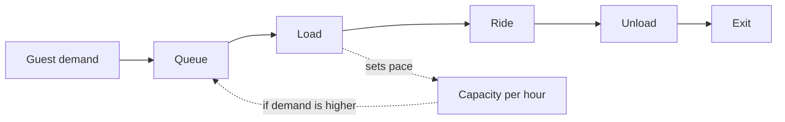

Throughput is the number of guests a ride can serve in an hour, and it is one of the most important numbers in park design. A spectacular attraction with low throughput generates long lines, unhappy guests and pressure on everything around it; a modest ride that moves 2,000 people an hour quietly props up the whole land. The queue exists because demand arrives unevenly while the ride serves guests at a fixed pace. When more people arrive than the ride can take, the line grows; when fewer arrive, it shrinks. Designers therefore work on both sides: raising capacity with bigger vehicles, more trains and faster loading, and shaping demand with virtual queues, timed tickets and the distribution of attractions across the park. The arithmetic lives in [throughput math](../operations-business/throughput-math.md). The guest side lives in [waiting](../human-factors/waiting.md), because a line is also an experience with its own psychology, and how long it feels matters as much as how long it is.

## Explore further
- [Throughput Math](../operations-business/throughput-math.md) — the formula behind riders per hour.
- [Perceived vs Actual Wait](../human-factors/perceived-vs-actual-wait.md) — why a 40-minute wait can feel like 20.
