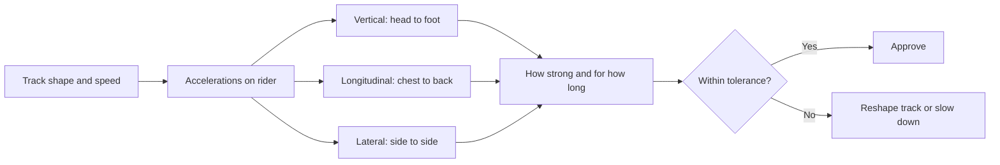

Every ride is a machine for applying forces to a human body. A drop makes you light, a valley presses you into the seat, a turn shoves you sideways, a launch pushes you back. Forces and human tolerance asks how much of each the body can take, for how long, and still enjoy it.

Engineers describe the forces in three axes: vertical (head to foot), longitudinal (chest to back) and lateral (side to side). The body copes best with vertical and chest-to-back loads and worst with lateral ones, which is why turns are banked. Duration matters as much as strength; a brief +5 g valley is fine where a sustained one is not. Standards such as ASTM F2291 publish acceleration-versus-time envelopes designers must stay inside, which is what [limits track geometry](../ride-engineering/track-geometry.md).

The foundations are in [g-force basics](../ride-engineering/g-force-basics.md). Forces also interact with the inner ear, where [motion sickness](../human-factors/motion-sickness.md) begins, and they feed the hazard list in [design safety](../safety-standards/design-safety.md).

## Explore further
- [G-Force Basics](../ride-engineering/g-force-basics.md) — the one number everyone quotes, explained.
- [Motion Sickness](../human-factors/motion-sickness.md) — when the body tolerates the force but the brain does not.
