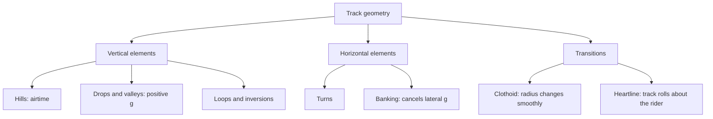

Track geometry is the shape of the ride, drawn as a path through space. Early designers sketched that path by hand and the forces were whatever came out. Today it works the other way round: the designer decides what the rider should feel at each moment, and software bends the track to produce it. That makes geometry the practical side of [g-force basics](../ride-engineering/g-force-basics.md).

The vocabulary is small. Vertical elements, such as hills, drops and loops, control how heavy or light you feel; the crest of a hill is what [causes airtime](../ride-engineering/airtime-and-negative-g.md). Horizontal elements are turns, and banking tilts the track so a sideways push becomes a downward one. The art is in the transitions. If the radius jumps, the g jumps, and riders feel a jolt; so modern track blends radii gradually with curves like the [clothoid loop](../ride-engineering/clothoid-loop.md) and rolls around the rider's heart rather than the rails. All [roller coasters](../ride-systems/roller-coasters.md) are built from these same pieces.

## Explore further
- [Clothoid Loop](../ride-engineering/clothoid-loop.md) — the teardrop shape that made loops survivable.
- [Forces & Human Tolerance](../ride-engineering/forces-and-tolerance.md) — the limits that every element must respect.
