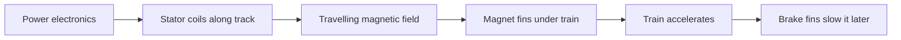

```formula
%% title: How hard a launch pushes | alt: Formulas for acceleration as change in speed over time and force as mass times acceleration, with a worked example of a 100 km/h launch in 2.5 seconds
a = \frac{\Delta v}{\Delta t}, \qquad F = m \cdot a
\Delta v = 100\ \text{km/h} \approx 27.8\ \text{m/s}, \quad \Delta t = 2.5\ \text{s} \;\Rightarrow\; a \approx 11.1\ \text{m/s}^2 \approx 1.1\,g
m = 8000\ \text{kg} \;\Rightarrow\; F \approx 8000 \times 11.1 \approx 89\ \text{kN}
```



A linear motor is an ordinary electric motor sliced open and laid flat along the track. The stator coils sit between the rails; the "rotor" is a row of fins under the train. Switch the coils on in sequence and they create a magnetic field that travels forward, dragging the fins along with it.

The two flavours differ in the fins. A linear synchronous motor (LSM) uses permanent magnets on the train and times the field to the train's position, which is efficient and precise. A linear induction motor (LIM) uses plain metal plates; the field induces currents in them, simpler but less efficient. Both are [launched coaster](../ride-systems/launched-coasters.md) systems with no contact and almost no wear.

The formula shows why riders notice: a modest launch adds about one extra g of push, so [g-force basics](../ride-engineering/g-force-basics.md) set the ceiling. It also relies on the [ride control system](../safety-standards/ride-control-systems.md) to fire only when the track ahead is clear.

## Explore further
- [Launched Coasters](../ride-systems/launched-coasters.md) — magnets compared with hydraulic and pneumatic launches.
- [Ride Control Systems](../safety-standards/ride-control-systems.md) — the logic that decides when a launch may fire.
