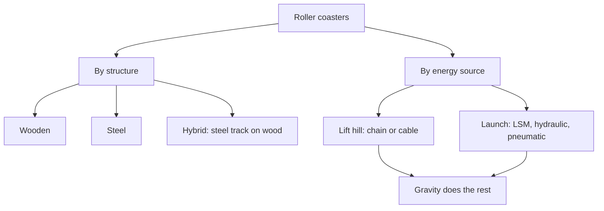

A roller coaster is a train of cars that rides a fixed track and is powered mostly by gravity. Energy is put into the train once, either by hauling it up a lift hill with a chain or cable, or by firing it out of the station as in [launched coasters](../ride-systems/launched-coasters.md). From that point the train coasts, trading height for speed and back again until the brakes catch it.

Designers usually sort coasters two ways. By structure, there are wooden coasters with laminated timber track, steel coasters with tubular rails, and hybrids that bolt steel track onto a wooden frame. By energy source, there are lifts and launches. Every branch of the family obeys the same physics, which is why [g-force basics](../ride-engineering/g-force-basics.md) apply to a gentle family coaster just as much as to a record-breaker.

The modern coaster descends from the gravity railways and scenic railways described under [early coasters](../history/early-coasters.md), and its shapes are still governed by [track geometry](../ride-engineering/track-geometry.md).

## Explore further
- [Launched Coasters](../ride-systems/launched-coasters.md) — how a train gets its energy in seconds instead of minutes.
- [Early Coasters](../history/early-coasters.md) — where the family came from.
