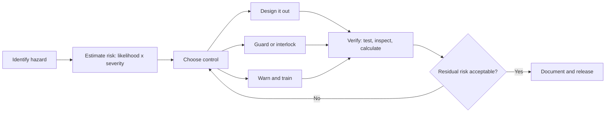

Design safety assumes something will go wrong and works out what, how often, and how badly, before any steel is cut. It runs alongside the creative work from concept to opening and is required by ASTM F2291, EN 13814 and ISO 17842.

The method is a loop. First list the hazards: a restraint that opens, a train that stalls on a hill. Rate each by how likely it is and how severe the outcome would be. Choose a control, preferring to design the hazard out, then guards and interlocks, and only last warnings and training. Verify the control works and check whether the leftover risk is acceptable. If not, go round again.

The worksheet version of this loop is [risk assessment and FMEA](../safety-standards/risk-assessment.md); the hardware that enforces it is the [ride control system](../safety-standards/ride-control-systems.md). Rider-side inputs come from [forces and human tolerance](../ride-engineering/forces-and-tolerance.md), and the whole process is scheduled into the [design pipeline](../design-process/pipeline-overview.md).

## Explore further
- [Risk Assessment & FMEA](../safety-standards/risk-assessment.md) — the worksheet behind the loop.
- [Ride Control Systems](../safety-standards/ride-control-systems.md) — where the controls become hardware.
