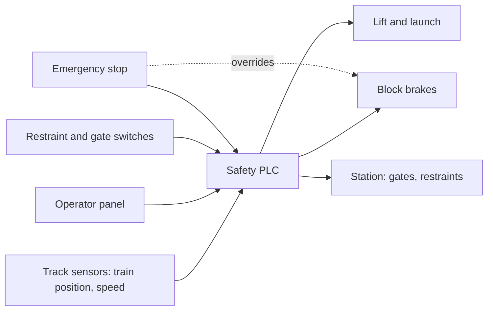

A modern ride is run by a programmable logic controller, or PLC: a rugged industrial computer that reads hundreds of sensors and decides what the ride may do next. Safety-rated versions use two processors checking each other, so one fault cannot cause an unsafe command.

Its most important job is block zones. The track is split into sections, each ending in a brake that can hold a train. Only one train may occupy a block, and it may enter the next only when that block is proven empty. If the logic is ever unsure, the brakes close. This is what [enables a safe dispatch interval](../operations-business/dispatch-interval.md) and also what caps it, because [throughput math](../operations-business/throughput-math.md) can never beat the block layout.

Around that core sit restraint and gate checks, the operator's panel, and the emergency stop, which bypasses normal logic and holds every train. Which checks exist comes from the [risk assessment](../safety-standards/risk-assessment.md), making the control system the enforcing arm of [design safety](../safety-standards/design-safety.md).

## Explore further
- [Dispatch Interval](../operations-business/dispatch-interval.md) — how block zones set the rhythm of a ride.
- [Risk Assessment & FMEA](../safety-standards/risk-assessment.md) — where each interlock is justified.
