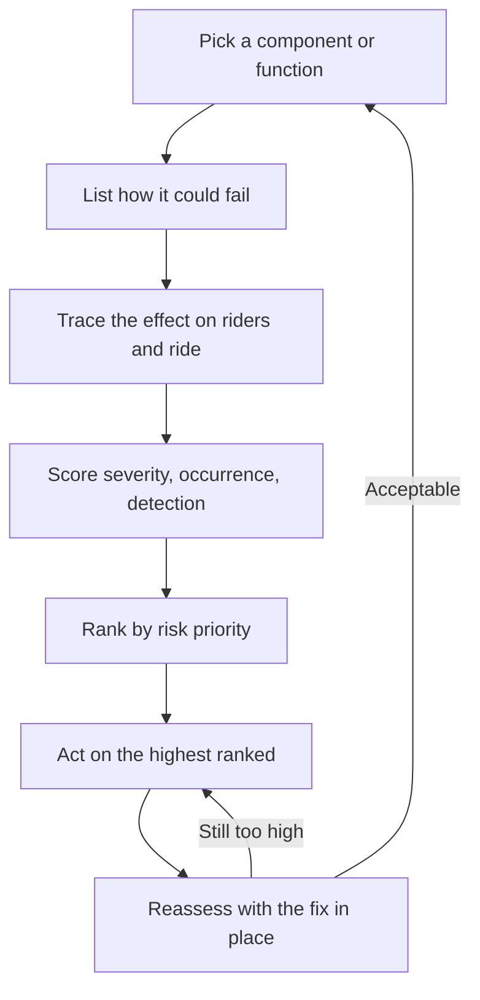

A risk assessment answers two questions about every part of a ride: how could this fail, and what would happen if it did? It is the working document behind [design safety](../safety-standards/design-safety.md), required by ASTM F2291, ISO 17842 and EN 13814.

The most common format is the FMEA, or Failure Mode and Effects Analysis. Take one component at a time, such as a lap bar lock, and write down each way it could fail. Trace the effect, then score three things: how severe the outcome is, how often it is likely to occur, and how easily it is detected. Multiplying the scores gives a risk priority number, so the worst problems get attention first; after a fix, the row is scored again.

FMEA findings decide which interlocks and redundant sensors the [ride control system](../safety-standards/ride-control-systems.md) must have, and feed back into physical design: assessing a [clothoid loop](../ride-engineering/clothoid-loop.md) means checking what happens if a train enters too slowly and stalls.

## Explore further
- [Design Safety](../safety-standards/design-safety.md) — the wider process the FMEA sits inside.
- [Ride Control Systems](../safety-standards/ride-control-systems.md) — turning an FMEA row into an interlock.
