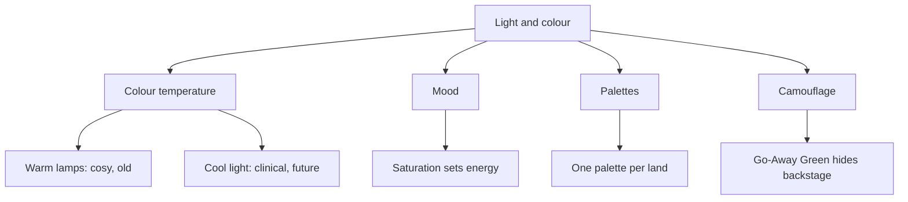

Light and colour are the cheapest and most powerful tools a park has. Colour temperature does a lot of the work: warm, orange-leaning lamps read as cosy, historic and safe, while cool blue-white light reads as modern, clinical or alien. Saturation sets energy, so a children's land is bright and a horror walkthrough is drained. Each land usually gets its own palette so guests feel the transition when they cross a boundary, even before they notice the architecture. Light also controls what is seen at all. Every reflection trick, including [Pepper's Ghost](../show-technology/peppers-ghost.md), only works because the lit figure is bright and the surroundings are black. And colour can make things disappear in daylight too: muted camouflage paints like [Go-Away Green](../sensory-environment/go-away-green.md) let utility buildings sit in plain sight. Because the eye adapts, designers also use darkness itself, lowering light in a queue so that the ride's first scene feels brighter and bigger than it is, a cousin of [forced perspective](../story-experience/forced-perspective.md).

## Explore further
- [Go-Away Green & Camouflage Palettes](../sensory-environment/go-away-green.md) — hiding things in plain sight.
- [Perception](../human-factors/perception.md) — how the eye adapts to light.
