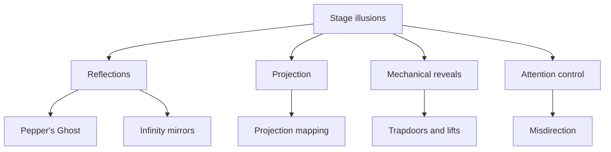

Theme parks inherited most of their tricks from the Victorian stage. An illusion is any technique that makes a guest perceive something different from what is physically in front of them: a ghost floating through a ballroom, a wall that seems to vanish, a figure that appears from nowhere. Most park illusions fall into four families. Reflections, like [Pepper's Ghost](../show-technology/peppers-ghost.md), use glass to place an image where no object exists. Projection paints moving pictures onto sets. Mechanical reveals use lifts, turntables and trapdoors to swap scenes. And attention control, better known as [misdirection](../show-technology/misdirection.md), steers the eye away from where the change happens. What ties them together is that none of them work alone; they only convince when the surrounding [spatial storytelling](../story-experience/spatial-storytelling.md) gives the guest a reason to look, and a reason not to look too closely.

## Explore further
- [Pepper's Ghost](../show-technology/peppers-ghost.md) — the reflection trick behind most ride ghosts.
- [Light & Color](../sensory-environment/light-and-color.md) — why illusions depend on controlling what is lit.
